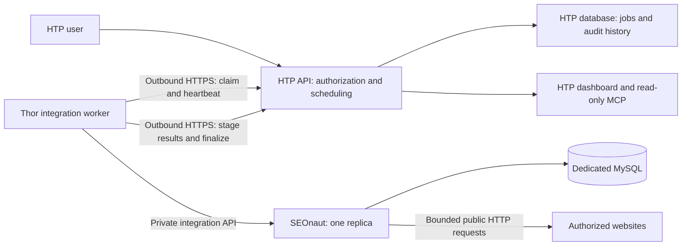

# SEOnaut on Thor: deployment and HTP integration plan

Status: original SEOnaut deployment proposal, superseded by the Seosmith Rust
backend implementation on October 31, 2026. No Thor deployment performed.

The user selected a native Rust backend at `/mnt/storage/projects/seosmith`
(`https://github.com/hatchertechnology/seosmith`). Its README, coverage document,
Kubernetes example and HTP integration directory now describe the implementation.
The design below remains historical context; the Go fork, MySQL and adapter
components are replaced by one Rust binary with SQLite and outbound HTP push.
Prepared October 30, 2026 (America/New_York).

## Objective

Run self-hosted SEOnaut on Thor's K3s cluster with no new SaaS subscriptions.
HTP owns website authorization, schedules, retained audit history, and client-facing
reports. Thor performs crawls and uploads results over outbound HTTPS. Existing
compute, disk, bandwidth, and HTP database limits still apply.

## Evidence and constraints

- Read-only live inspection confirmed Thor Ready on K3s v1.34.4+k3s1,
  Argo-managed applications, the SOPS Secrets Operator, and `zfs-local` storage
  with Retain reclamation. No MySQL/MariaDB Deployment or StatefulSet appeared
  in the inspected workload names; this does not prove none exists elsewhere.
- Local Thor runbooks document single-node operation, Tailscale private ingress,
  SOPS-managed secrets, and dedicated ZFS datasets. Historical resource figures
  must be refreshed before deployment; no current free-capacity claim is made.
- SEOnaut source inspected at commit
  `a67387fe63a291be2ba49dd02399f20e453eb8b5` (MIT license).
  It uses Go and MySQL; do not substitute Thor's PostgreSQL operator.
- `internal/routes/app.go` exposes cookie-session web routes, including crawl
  start/stop, progress WebSocket, and CSV exports. No dedicated integration API
  or completion webhook was found in the inspected routes.
- `internal/services/crawler.go` maintains active crawlers in process memory,
  removes the preceding crawl's detailed data after a new crawl, and calculates
  cross-page issues after fetching finishes. Its current crawl cap is a constant
  of 20,000 pages. Run one application replica initially.
- `internal/services/export.go` exports page metadata, but its all-page CSV does
  not enumerate every page's issue identifiers. A CSV-only integration would lose
  evidence unless issue-specific exports were collected separately.
- HTP already uses durable claims, leases/fencing, owner-scoped reads, saved
  provider observations, and explicit freshness/error states. Reuse the pattern,
  without coupling SEO audits to Google or Bing connection state.

## Architecture

HTP never needs a public route into Thor. Staff may inspect the SEOnaut UI through
private Tailscale ingress. HTP users access reports through existing HTP login;
SEOnaut UI authentication remains separate in the first version. Native SEOnaut
OIDC support was not established; Keycloak integration is not a prerequisite.

## Kubernetes deployment

Use a dedicated namespace, provisionally `htp-seonaut`. Keep manifests, image
build definitions, encrypted secrets, and the runbook in a dedicated Forgejo
GitOps repository; exact repository identity is to be selected at implementation.
Register an Argo application only after the source is ready.

| Workload | Initial proposal | Persistence |
| --- | --- | --- |
| SEOnaut | One-replica Deployment, Recreate rollout; pinned integration build | Temporary files only while archiving is disabled |
| MySQL | Single-instance StatefulSet; validate a maintained MySQL 8.4 image and pin its digest | Dedicated retained PV/PVC; proposed 10 GiB quota |
| Integration worker | One-replica Deployment; bounded polling, no Kubernetes write permissions | Reconstruct state from durable jobs and local crawl IDs |
| Database backup | Scheduled Job using database-consistent dumps | Existing approved backup destination with bounded retention |

Proposed starting requests/limits, subject to pilot measurements:

- SEOnaut: 250m CPU / 512 MiB requested; 2 CPU / 2 GiB limit.
- MySQL: 250m CPU / 512 MiB requested; 1 CPU / 1 GiB limit, with explicit
  buffer sizing appropriate to that memory limit.
- Worker: 100m CPU / 128 MiB requested; 500m CPU / 256 MiB limit.
- Scratch space: bounded emptyDir and ephemeral-storage limits.

Use the existing dedicated-ZFS/Retain convention, with a proposed new dataset
under `/hatch1/services/seonaut`. Confirm actual pool headroom and ownership
before creating it. Protect storage and encrypted secrets from Argo pruning.
Do not share database credentials or writable schemas with unrelated applications.

Pin source revisions and image digests; inspect build stages and dependency age
before adopting the upstream Dockerfile unchanged. Add readiness/startup checks
appropriate to actual application and migration behavior. Do not have liveness
restart an otherwise healthy application merely because HTP is unavailable.

## SEOnaut integration interface

Recommended: maintain a minimal MIT-licensed fork adding a private, versioned,
authenticated JSON API around existing project/crawl/report services. Keep this
code independent from HTP's reporting rules and propose reusable changes upstream.
The following are proposed endpoints, not existing upstream capabilities:

- Ensure a project exists for a trusted binding and approved crawl configuration.
- Start a crawl using an idempotent external run identifier.
- Read crawl status, including terminal outcome and coverage/stop reason.
- Read summary, pages, issue definitions, and page/issue associations by crawl ID,
  with stable cursor pagination and an explicit export-complete marker.
- Stop a run and reconcile abandoned work after restart.
- Readiness/health and basic operational metrics.

Persist external-run-to-crawl mappings before acknowledging starts. Enforce
binding authorization server-side and idempotent start retries. A network timeout
must not trigger another crawl blindly. Treat page fetching as incomplete until
cross-page issue analysis and export finish.

Preserve completed crawl evidence until HTP has acknowledged its complete import;
either gate the next crawl for that project or add bounded retention in the fork.
Fence UI-triggered crawls too: they must not delete a run awaiting import.
Recover interrupted crawls as interrupted/retryable, never successful empty audits.

Alternative for an early connectivity proof: a private session-authenticated
adapter over upstream web/CSV routes. It is less stable and cannot be treated as
the final complete issue contract. Do not build production HTML scraping or
cross-service MySQL queries into HTP.

## HTP job and ingestion contract

1. An authenticated HTP user enables auditing for an owned website. HTP records a
   stable binding ID, owner, website ID, exact FQDN, approved hostname aliases,
   configuration generation, schedule, and limits.
2. An HTP scheduler creates a due run. Dashboard reads do not enqueue duplicate
   runs. A manual request uses the same queue and rate limits.
3. Thor claims a run through a dedicated worker API using a scoped, revocable
   worker credential. HTP chooses the binding; the worker cannot supply arbitrary
   ownership. Do not put a Supabase service-role key on Thor.
4. HTP returns a lease/fencing token. The worker renews it during long crawls;
   expired work is reconciled against the persisted local run mapping before retry.
5. Thor ensures the project, starts/attaches to the run, waits for full analysis,
   and uploads bounded batches of pages and findings into staging records.
6. Batch keys/checksums make retries idempotent. Finalization verifies run/binding
   generation, counts, schema version, and all expected batches, then publishes
   the observation atomically. Reject stale workers and cross-binding payloads.
7. Thor retries upload of the same immutable results if HTP is unavailable. It
   does not recrawl solely because an upload failed. Retained local evidence is
   acknowledged only after HTP publication succeeds.

Proposed logical records (names to align with implementation):

- `seo_audit_bindings`: website/owner mapping, approved targets, generation, policy.
- `seo_audit_jobs`: due time, state, attempt, lease token, heartbeat and errors.
- `seo_audit_runs`: external/local IDs, timestamps, source/config versions,
  totals, scope, coverage, termination reason and import state.
- `seo_audit_pages`: canonical page identity, observed URL, status, metadata,
  indexability observations, depth and other supported measurements.
- `seo_audit_findings`: original issue key, severity and evidence, affected URL,
  run ID and stable comparison key.

Reuse HTP ownership/RLS boundaries. Bindings are not inferred from a hostname
alone. Website rename/deletion or disabled auditing invalidates outstanding work;
old-host results never appear under the renamed website. Workers cannot alter
website ownership or fetch user OAuth grants. Display upstream critical/alert/
warning labels through an explicit, versioned severity mapping.

## Initial crawl policy and retention

- Pilot one existing owner-approved website first; proposed 500-page cap, one
  active crawl globally, and a 30-minute deadline including analysis.
- Respect robots.txt; exact hostname scope with explicit aliases only; no
  authenticated pages, form submissions, or unrestricted subdomains.
- Proposed maximum one request per second per target origin, with bounded
  resource checks. These are desired controls: add/verify configuration in the
  fork rather than assuming upstream's current constant limits expose them.
- Disable full-page archiving initially. Retain metadata and issue evidence only.
- After the pilot, stagger weekly crawls during an overnight window in
  America/New_York. Keep scheduling authority in HTP rather than independent
  competing schedules in both applications.
- Proposed local retention: last acknowledged detailed run plus unacknowledged
  results, with a disk cap and backpressure. Never delete pending results just to
  make room for another crawl.
- Proposed HTP retention: 90 days of page/finding details and 12 months of compact
  summaries, with explicit record/storage quotas. Confirm this fits the existing
  database allowance; free software does not guarantee free hosted storage.

Compare findings only across compatible scope, configuration and issue versions.
Page caps, robots exclusions, interruptions, and fetch failures remain visible.
Do not label an issue fixed merely because its page was outside a later crawl.

## Network and credential boundaries

Keep MySQL and the integration API cluster-private; grant only the necessary
worker/app access. Expose staff UI privately through the existing Tailscale
pattern. Use SOPS-delivered secrets, distinct database/worker/API credentials,
rotation, and sanitized logs. Disable public signup or constrain it through the
private reverse proxy if upstream lacks a suitable setting.

Crawlers on Thor must not fetch LAN services, pod/service networks, metadata
endpoints, loopback or other nonpublic destinations. Validate DNS resolutions and
redirects at connection time, including external resources and sitemap URLs;
combine application checks with enforced egress restrictions. Explicitly allow
only required DNS and database paths. Validate actual K3s policy enforcement with
negative tests; a NetworkPolicy object alone is not proof of isolation.

## Reports and acceptance tests

HTP's technical SEO view should show crawl time, freshness, scope/completeness,
page totals, severity counts, actionable findings, affected URLs, and comparable
new/resolved/persistent issues. Existing successful reports stay readable during
collection failures. Extend read-only MCP access for audit sources and complete
paginated runs/findings; do not expose worker controls through research reads.

Required acceptance checks:

1. A fixture site with known broken links, duplicate titles and redirects produces
   matching SEOnaut and HTP totals and complete page/issue evidence.
2. Crawl restart, worker restart, lost lease and repeated uploads cannot create
   duplicate published runs or delete unacknowledged evidence.
3. A capped/interrupted crawl is visibly partial; omitted findings are not resolved.
4. HTP outage permits a later upload without a new crawl.
5. Cross-owner reads/writes, stale binding generations and revoked credentials fail.
6. Private-address targets, redirect/DNS escape paths and prohibited external
   resources are blocked; ordinary approved public crawls still work.
7. Database dump restores into an isolated instance and supports a usable report.
8. Load/resource/storage measurements fit the agreed existing capacity and quotas.

## Delivery sequence

1. Confirm current Thor capacity, backup destination and GitOps repository; pin
   upstream revision and validate image/database compatibility.
2. Define the versioned export schema and add the minimal private API, crawl
   bounds, safe fetching, idempotency and acknowledged-retention behavior.
3. Stage HTP schema and worker endpoints with authorization/lease/import tests.
4. Prepare GitOps deployment, retained storage, secrets, private access and backups.
5. Deploy a single-site pilot when implementation/deployment is requested; verify
   end-to-end import, recovery and isolation before enabling recurring collection.
6. Add HTP dashboard/MCP reporting and then expand to the remaining enabled sites.

## References

- [SEOnaut repository](https://github.com/StJudeWasHere/seonaut)
- [Inspected route source](https://github.com/StJudeWasHere/seonaut/blob/a67387fe63a291be2ba49dd02399f20e453eb8b5/internal/routes/app.go)
- [Inspected crawler lifecycle](https://github.com/StJudeWasHere/seonaut/blob/a67387fe63a291be2ba49dd02399f20e453eb8b5/internal/services/crawler.go)
- [Inspected CSV exporter](https://github.com/StJudeWasHere/seonaut/blob/a67387fe63a291be2ba49dd02399f20e453eb8b5/internal/services/export.go)
- HTP patterns: `docs/google-sync.md`, `docs/bing-sync.md`, `docs/mcp-seo.md`.
- Thor local references: `/mnt/storage/projects/thor/docs/thor/kubernetes.md`,
  `/mnt/storage/projects/thor/docs/thor/storage.md`, and
  `/mnt/storage/projects/thor/keycloak/README.md`.
